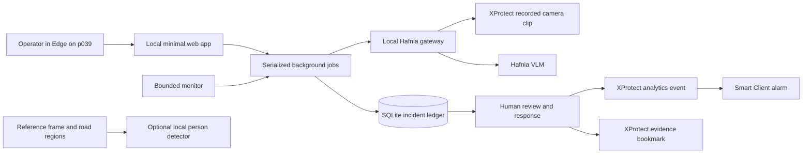

# RoadWatch MVP architecture

## Operational boundaries

- Server listens only on 127.0.0.1:8765. Use Edge inside p039. No public hosting, firewall changes, CORS changes, or Tailscale changes.
- Credentials live in server memory for the connection session. They are not returned by state APIs, written to logs, SQLite, exports, or backups. Disconnect or restart forgets them.
- API mutations require exact Host, same-origin Origin, and a random session token. Model text and notes are rendered with textContent. No remote scripts or fonts are loaded.
- Only one upstream operation runs at once. Reads and response notes remain available while an assessment is processing.
- Monitoring sessions have a time limit and request-attempt limit. They never restart automatically. Stop allows an already submitted summary to complete.
- Completed clip assessments are validated; malformed, conflicting, limited-visibility, or nonpersistent obstruction responses require review.
- Same camera/type observations within ten minutes may join an open episode. This is grouping, not object identity, continuity, or causal proof. Closed episodes are not reopened automatically. Long gaps create another item. Non-overlapping clip seconds are shown separately from elapsed time; persistence is never marked verified automatically.
- Delivery is claimed durably before its POST. An ambiguous outcome blocks another automatic attempt. Manual and monitored flows share the same claim. HTTP 202 is acceptance, not proof of an alarm being displayed.
- Synthetic or looping sources cannot use automatic delivery. On explicitly configured live non-looping sources, optional auto delivery requires at least two non-overlapping candidate observations. This remains experimental and does not prove sustained lane obstruction.
- Clear model observations do not close incidents. Human confirmation plus a note is required. Local status is intentionally separate from XProtect alarm state; alarm-state synchronization is not implemented.

## Detection scope

Hafnia provides context from recorded video. Initial manual tests found both roadworks false positives and a possible missed worker interaction. Current prompts are not validated for deployment on public roads.

Road regions are saved against a current reference snapshot. They do not change the gateway's video input. Optional local YOLO inference checks person footpoints against polygons on a newly requested snapshot. It does not establish traffic conflict, intent, speed, authorization, or continuous presence. That snapshot is explicitly separate from the assessed recorded clip. Nothing automatically claims it validates an earlier incident.

The core app runs without a detector package. The optional path needs separately installed dependencies and local pretrained weights; no model is trained. Camera movement invalidates manually defined regions; automatic camera-change detection is not implemented. Review regions after any change to the view.

## Data and recovery

runtime/roadwatch.sqlite3 contains camera configuration, incidents, observations, actions, evaluation labels, request reservations and event receipts. runtime/frames contains setup JPEGs. runtime/*.json remains compatible with the original CLI tools and imports idempotently. Imported old event receipts prevent resending the same grouped incident.

Settings includes configuration export, evaluation CSV and workspace ZIP backup. Copy downloads off the remote machine. Restore with the server stopped by extracting roadwatch.sqlite3 and frames/ into runtime/, retaining a copy of the existing runtime directory first. Do not restore over an active database.

CLI check/event commands remain diagnostic tools. Their independent submissions do not share the web app's request reservations; use the app for monitored operation. Gateway quota checks include other completed requests, but organizer counts can lag. The local cap counts attempts conservatively, even failures or unknown outcomes.

## Official contracts

- Gateway endpoints and quota fields: HackathonKit/hafnia-vlm/references/gateway-api.md and xprotect-hackathon/references/vlm-allowance.md.
- Cameras, analytics event discovery and JPEG tasks: https://doc.developer.milestonesys.com/mipvmsapi/api/config-rest/v1/openapi.yaml
- Analytics event submission: https://doc.developer.milestonesys.com/mipvmsapi/api/events-rest/v1/
- Bookmarks: https://doc.developer.milestonesys.com/mipvmsapi/api/bookmarks-rest/v1/openapi.yaml
- Optional detector: https://docs.ultralytics.com/modes/predict/
